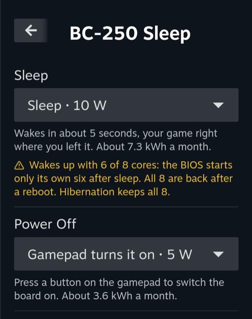

# bc250-sleep

A real sleep for the **AMD BC-250** running SteamOS, Bazzite or CachyOS: Steam's **Sleep** puts the board
into hibernation or into ACPI S3. **Power Off** is replaced with a hibernation that saves no state, so the
gamepad can switch the board on.

> [!WARNING]
> Tested only on SteamOS with the CPU unlock done in the BIOS. Use at your own risk.

The easiest way to install it is the Decky plugin.



## The sleeps

| Mode | Down / up | At the plug | Notes |
|---|---|---|---|
| `hibernate` | about a minute / about 20 s | 5-6 W | the image goes to the swap file; with the 8-core unlock all cores come back |
| `s3` (default) | under a second / about 5 s | about 10 W | cores unlocked beyond the firmware's six stay off until a reboot |

On a board with the 8-core unlock, once an S3 sleep has left the extra cores offline, the rest of that boot
sleeps in S3 too: a hibernation started from there hung in testing. What cannot be done in a boot is
replaced: the hibernation by S3, and S3 by no sleep at all. A sleep that cannot work is never entered.

Wake-up: any USB device that can wake (gamepads, the Steam Controller's dongle, keyboards) in a blue USB 3.0
port. Bluetooth gamepads cannot wake the board.

## Power off

About 5 W at the plug. The board powers off through the hibernation path, so USB stays armed and the
gamepad switches the board on; every start is a fresh boot. Only from a blue USB 3.0 port, not over
Bluetooth.

## Requirements

- AMD BC-250 with a P3.00-based BIOS: the stock P3.00 or a modded one built on it (it still reports
  P3.00). On other versions the BIOS option for S3 is not written, so only the hibernation works.
- SteamOS, Bazzite or CachyOS, and the network: the modules are built on the board for its kernel.
- For S3 on a board with the 8-core unlock: the kernel parameter `nvme.poll_queues=1`. The install adds it
  and the uninstall takes it out again; it counts from the next reboot.
- A swap file or partition for the hibernation (SteamOS has one; Bazzite and CachyOS have only zram, so
  their Sleep takes S3 until one is added).

## Install

### Decky plugin

Download `bc250-sleep-<version>-Decky.zip` from the releases, install it from Decky's developer settings
("Install plugin from ZIP"), open **BC-250 Sleep** in the Quick Access menu and press **Install**, then
reboot once. The zip carries the whole package, so the plugin's version is the package's version.

To build the zip yourself: `decky-plugin/build.sh` (needs pnpm), then zip `decky-plugin/out/bc250-sleep`.

### By hand

```sh
sudo ./install.sh
sudo reboot            # the S3 table and the BIOS option count from the next boot
/etc/bc250-sleep/bc250-sleep status
```

`install.sh`:

- installs the compiler and the kernel's build files when they are missing (see For developers), and builds the
  two kernel modules;
- puts the S3 table (`acpi/SSDT-S3.aml`) into the boot. On SteamOS it goes into the ACPI override archive
  `/boot/acpi_override.cpio`; if there is none, it creates the archive and has GRUB load it
  (`/etc/default/grub.d/bc250-sleep-acpi.cfg`), and if the board has the master copy of another BC-250
  package that keeps that archive across SteamOS updates (`/var/lib/bc250-acpi-fix`), that copy is changed
  too. Elsewhere the initramfs generator takes it (see For developers);
- points `systemd-suspend.service` (Steam's Sleep) at `/etc/bc250-sleep/bc250-sleep`;
- enables a check at every boot, which also writes the BIOS option described in
  [docs/how-it-works.md](docs/how-it-works.md) when it is missing;
- on SteamOS, lists its files in `/etc/atomic-update.conf.d/bc250-sleep.conf`, so that an update keeps
  them.

### After a system update

An update brings a new kernel; on SteamOS it also replaces the system partition, and the compiler and the
build files are gone. At the first boot after it, `bc250-sleep-update.service` waits for the network,
installs what is missing, builds the modules for the new kernel and runs the boot check again; if the S3
table no longer reaches the kernel, it puts it back (that counts from the next reboot). Until then the Sleep button takes what the boot can do
without the modules. If it fails (no network, or a beta kernel whose build files are not published yet),
the plugin shows it and has a button to try again; by hand: `sudo /etc/bc250-sleep/bc250-update`, and
`/etc/bc250-sleep/bc250-update check` says what is missing.

## Use

```sh
sudo /etc/bc250-sleep/bc250-sleep mode s3        # or hibernate
sudo /etc/bc250-sleep/bc250-sleep shutdown wake  # or default
sudo ./install.sh --uninstall
```

Settings go into `/etc/bc250-sleep/config` (installed from `config.example` once). The log is
`/var/lib/bc250-sleep/sleep.log`; lines from the kernel side carry `bc250_pm:` and `gfxcsb:`.

## Documentation

- [How it works](docs/how-it-works.md): why each step is there.
- [Unlocked cores after S3](docs/s3-cores.md): what was tried to bring them back, and what might help.

## For developers

### What differs between systems

| | SteamOS 3.9 | Bazzite | CachyOS |
|---|---|---|---|
| compiler and build files | pacman: `base-devel` and the `<kernel>-headers` of the running kernel | build files in the image (kernel-devel); gcc in a podman image (`localhost/bc250-sleep-build`, Fedora of the same release), built once | pacman: `base-devel`, `clang llvm lld` (its kernels are built with clang, so are the modules) and `<kernel>-headers` |
| S3 table | `/boot/acpi_override.cpio`, loaded by GRUB | dracut `acpi_override`, in an initramfs rpm-ostree builds on the board (`rpm-ostree initramfs --enable`) | mkinitcpio hook `acpi_override` (`/etc/mkinitcpio.conf.d/bc250-sleep.conf`) |
| kernel parameters | `/etc/default/grub.d/bc250-*.cfg` | `rpm-ostree kargs` | `/etc/limine-entry-tool.d/bc250-sleep-*.conf` with Limine, `/etc/default/grub` with GRUB |
| kept over updates | `/etc/atomic-update.conf.d/bc250-sleep.conf` | `/etc` is kept | nothing to do |

SteamOS is what it is tested on; on Bazzite and CachyOS the build of the modules and the boot changes are
checked, a sleep there is not yet. Other systems: whatever compiler and build files are installed are used,
and the S3 table and the kernel parameters are left to you (`bc250-update check` says what is missing).
On a system with SELinux (Bazzite) the scripts and modules get the labels systemd and the kernel need.

### Unlocked cores after S3

After S3 the firmware starts only its own six cores; the extra two (CPUs 6, 7, 14, 15) stay offline until a
reboot. Even the unlock in the BIOS (DXE) does not bring them back: DXE does not run on the way back from S3,
and redoing the unlock there with a reset hangs the firmware.

Help wanted: [docs/s3-cores.md](docs/s3-cores.md) has what was tried, with the registers and results, and
what might help.

### Layout

| Path | What it is |
|---|---|
| `bc250-sleep` | the sleep itself: `boot`, `status`, `mode`, `shutdown`, and a sleep when run without arguments |
| `bc250-poweroff` | the power-off the gamepad can undo (`shutdown wake`) |
| `bc250-update` | the compiler and build files, the modules for the running kernel, the S3 table: after a system update |
| `install.sh` | install, update, `--uninstall` |
| `config.example` | settings of the board |
| `src/` | `bc250_pm`, the helper module |
| `gfxcsb/` | the module that has amdgpu submit the gfx clear state again |
| `acpi/` | the S3 table, source and compiled |
| `systemd/` | the boot check, the run of `bc250-update` after it, and the drop-ins for `systemd-suspend.service` and `systemd-poweroff.service` |
| `tools/` | `system.sh` (what differs between SteamOS, Bazzite and CachyOS), the BIOS option, the watchdog, the disk's kernel parameter, the ACPI archive, the offset of the GPU driver's flag |
| `decky-plugin/` | the Decky plugin: installs the package, and a menu for Sleep and Power Off |
| `docs/` | how it works |

## License

GPL-2.0-only, see [LICENSE](LICENSE).
